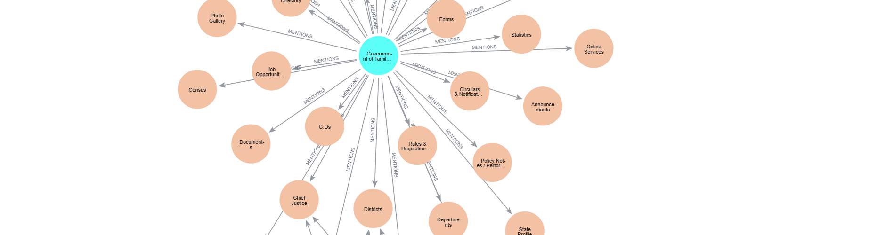
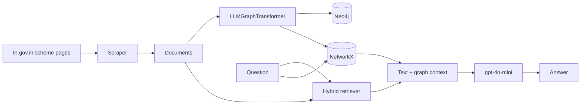

# Tamil Nadu Government Schemes Knowledge Graph (KG-RAG)

> Turn government scheme pages into a knowledge graph and ask questions that use both text and relationships.

      

## Overview

Scheme pages describe who is eligible, which department runs a scheme and what it provides, which is naturally a graph. This project scrapes the Tamil Nadu government [scheme list](https://www.tn.gov.in/scheme_list.php?dep_id=Mg==), uses an LLM to extract entities and relationships, stores them in **Neo4j** and **NetworkX**, and answers questions with **graph context plus hybrid text retrieval**.

## Features

- Scheme page scraping (Playwright + BeautifulSoup)
- LLM-based entity and relationship extraction (`LLMGraphTransformer`)
- Graph stored in **Neo4j** (Aura or local) and mirrored in **NetworkX**
- Hybrid retriever over scheme text
- Answers combine retrieved text with graph neighbourhoods
- Standalone scripts for Neo4j-only and NetworkX-only experiments

## Demo



## How it works



## Tech stack

| Layer | Technology |
|---|---|
| UI | Streamlit |
| Graph | Neo4j, NetworkX |
| Orchestration | LangChain, `langchain-experimental` |
| Models | OpenAI `gpt-4o-mini`, `text-embedding-3-small` |
| Scraping | Playwright, BeautifulSoup |

## Project structure

```text
.
├── KG_RAG.py            # full pipeline + Streamlit app
├── tngov_neo4j.py       # build the graph in Neo4j only
├── tngov_networkx.py    # build and query the graph with NetworkX only
├── visualisation.png
├── requirements.txt
└── .env.example
```

## Getting started

**Prerequisites:** Python 3.10+, a Neo4j database (local or [Neo4j Aura](https://neo4j.com/cloud/aura/))

```bash
git clone https://github.com/prasanth-sundararajan/tngov_Knowledge_Graph.git
cd tngov_Knowledge_Graph
python -m venv .venv
# Windows: .venv\Scripts\activate    macOS/Linux: source .venv/bin/activate
pip install -r requirements.txt
playwright install chromium
```

Copy `.env.example` to `.env` and add your keys:

```bash
cp .env.example .env
```

## Usage

```bash
streamlit run KG_RAG.py
```
The first run scrapes the scheme pages and builds the graph; then ask questions such as *"Which schemes support women entrepreneurs?"*

## Configuration

| Variable | Required | Description |
|---|---|---|
| `OPENAI_API_KEY` | Yes | OpenAI API key used for chat and embeddings |
| `NEO4J_URI` | Yes | Neo4j connection URI (e.g. `neo4j+s://...`) |
| `NEO4J_USERNAME` | Yes | Neo4j user |
| `NEO4J_PASSWORD` | Yes | Neo4j password |
| `NEO4J_DATABASE` | No | Database name (defaults to the username) |

## License

Released under the [MIT License](LICENSE).

## Author

**Prasanth Sundararajan**, Senior SRE and AI Engineer  
[LinkedIn](https://www.linkedin.com/in/prasanth-s-a093a7109/) · [GitHub](https://github.com/prasanth-sundararajan)
